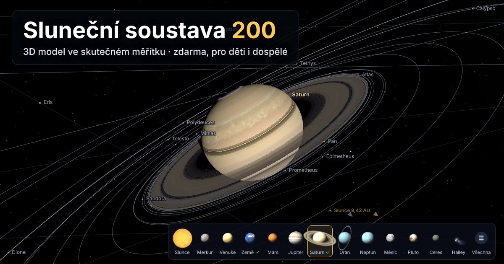

# Sluneční soustava 200



Interaktivní 3D model Sluneční soustavy v prohlížeči: 201 těles ve skutečném měřítku a na skutečných drahách,
dospělé a dětské rozhraní, minutová ukázka ovládání, čtyři pohledy na Slunce, zvuky, hudba a hra pro mladého astronoma.

- **Spustit:** https://ondrejkaplan-drm.github.io/SlunecniSoustava2026/
- **Verze:** 1.2 (13. 11. 2026); rozpracovaná 1.8a na větvi `iterace-19` (přehled změn: `docs/ZMENY.md`) · zdarma, bez reklam, bez registrace a bez sběru dat
- **Bez internetu:** `npm run offline:hi` vyrobí jeden soubor HTML, který se otevře dvojklikem (na flashku, do školy)
- **Autor:** Ing. Ondřej Kaplan, Ph.D. (ondrej.kaplan@gmail.com) – námět, zadání, odborná kontrola a testování. Kód napsal podle jeho zadání model Claude Fable 5.2 (Anthropic).
- **Licence:** kód MIT (`LICENSE`); mapy, písmo, zvuky a hudba mají vlastní licence – přehled v `CREDITS.md`

## Co aplikace umí
- Skutečné měřítko 1 : 1 a skutečné polohy těles pro libovolné datum (stroj času se slavnými okamžiky).
- 44 těles se skutečnou mapou ze snímků sond, 21 z nich s velkou mapou načítanou až zblízka; ostatní povrchy jsou označené ilustrace.
- Slunce počítané za běhu: bílé světlo, H-alfa, EUV 304 Å a koronograf.
- Dětské rozhraní s přirovnáními, hádankami, deníkem a albem; dospělé s jednotkami a zdroji.
- Počítač, tablet, telefon i velká obrazovka (☰ → Zobrazení).

## Jak se hlídá správnost
- `npm test` – regresní ukázka ovládání v prohlížeči (10 kroků, bez chyb v konzoli).
- `npm run test:fakta` – shoda dat, textů a výpočtů (hustoty, rozměry, výstřednosti, průlet Apophisu 2029).
- `docs/VYDANI.md` – kontrolní seznam před každým zveřejněním.
- Co je skutečné a co ilustrace, říká aplikace na kartě každého tělesa; přesnost a meze výpočtů jsou v `CREDITS.md`.

## Rychlý start

```sh
npm install          # three, esbuild, sharp, prettier
npm run build        # src/ → dist/app.js (jeden minifikovaný soubor)
npm test             # regresní ukázka ovládání, musí skončit 10/10 (potřebuje Playwright s Chromiem)
npm run offline:hi   # verze v jednom souboru HTML včetně velkých map (na flashku)
npm run format       # jednotné formátování zdrojáků (Prettier)
```

Aplikaci tvoří složka `dist/` – stačí ji vystavit libovolným statickým serverem.

## Struktura

```
src/                  zdrojový kód (ES moduly)
  main.js             vstupní bod: sestaví engine, zvuk, rozhraní a spustí smyčku
  core/               výpočty bez vykreslování
    sim.js            katalog těles, polohy, Měsíc, čas (ΔT), natočení (IAU; Země s precesí), tvary
    ephem.js          efemeridy: planety (přesný fit 1900–2050 + dlouhodobá teorie −1000 až 3000), malá tělesa, měsíce
    shape.js          trojosé tvary malých těles
    asset.js          adresa souboru (nebo data URI ve verzi v jednom souboru)
    flags.js          registr funkcí: kdo kterou funkci uvidí (obě rozhraní, jen dospělí, jen ?dev)
    device.js         třída zařízení a rozpočet paměti pro chytré načítání
    preload.js        přednačtení s lištou, která necouvá
  render/             vykreslování (WebGL, Three.js)
    engine.js         scéna, kamera, lety, načítání map (malé a velké), souhvězdí, 2D vrstva
    shaders.js        GLSL: tělesa, Slunce, prstence, atmosféry, hvězdy, souhvězdí
    belts.js          hlavní pás planetek a Kuiperův pás (ilustrační tečky na skutečných typech drah)
    l2.js             podrobné mapy zblízka (úroveň 2): dlaždice 16k/8k jen pro těleso v ohnisku a jen v záběru, jeden atlas v grafice
    ball.js           kotouče těles na 2D plátně (porovnání velikostí, ikony)
  ui/                 rozhraní
    ui.js             karta tělesa, lišty, hra, klávesy a ukazatel
    extras.js         2D vrstva: útvary, sondy, pravítko, minimapa
    orient.js         šipky ke Slunci a Zemi, orientační body
    mobile.js         rozložení podle zařízení: telefon, tablet, velká obrazovka, malé okno
    superkarta.js     podrobná karta tělesa (pětiklik; jen dospělé rozhraní)
    udalosti.js       úkazy na obloze: seznam, karty, ukázka a návrat
    tutorial.js       dvouminutová ukázka ovládání (každá kapitola si sama připraví pohled)
    zvuky.js          zkušebna zvuků
  audio/
    audio.js          syntéza, nahrávky, prostředí těles, hudba
  data/               data (negenerují se při sestavení, neformátují se)
    cat.json          katalog těles (201)
    hi.json           seznam těles s velkou mapou (dist/maps/hi/)
    stardata.js       hvězdy a čáry souhvězdí
    connames.js       česká jména souhvězdí a hvězd
    facts.js          zajímavosti k tělesům
    zvuky.json        seznam zvuků zkušebny
dist/                 hotová aplikace
  index.html          stránka, styly a prvky rozhraní
  app.js              výstup sestavení (needitovat ručně)
  icons.webp          atlas ikon těles
  maps/               mapy těles (WebP); maps/hi/ = velké mapy načítané až zblízka
  music/, zvuky/      skladby a zvuky (MP3)
tools/                nástroje (spouštět z kořene repa)
  build/              build_offline.mjs – verze v jednom souboru
  test/               tut.mjs (regrese), t_fakta.mjs (shoda dat a textů), t_model.mjs (věrohodnost poloh proti JPL DE422), t_hi.mjs (velké mapy), shot.mjs, mobshot.mjs, sunshot.sh, t_*.mjs
  maps/               make_hi.py (velká mapa z mozaiky), make_saturn.py, tone_proc.py, starší převody
  model/              dlouhodobá teorie planet: fit na JPL DE422, měření věrohodnosti (viz docs/VEROHODNOST.md)
  data/               stavba katalogu, ikon a dat (část potřebuje repo Oliverovy Planetky 8)
  zvuky/              výběr a převod zvuků CC0
  archiv/             zastaralé skripty, nepoužívat
zdroje/               původ dat: MAPY.md (zpracování map), ZVUKY.md; licence všech podkladů shrnuje CREDITS.md
docs/                 poznámky k architektuře
```

## Rozpracované funkce a přepínač `?dev`
Kdo kterou funkci uvidí, určuje jediný soubor `src/core/flags.js`. Každá funkce má stav `vse` (obě rozhraní), `dospeli` (jen dospělé rozhraní),
`dev` (jen ve vývojářském režimu) nebo `vyp`. Schování funkce je změna jednoho slova, kód se nemaže.

| Adresa | Co udělá |
|---|---|
| `…/index.html?dev` | zapne vývojářský režim: funkce ve stavu `dev` a technický výpis načítání na úvodu |
| `…?dev=superkarta,nacitani` | zapne jen vyjmenované funkce |
| `…?dev=0` | vypne a zapomene |
| `…?zvuky` | zkušebna zvuků (jako dřív) |

Volba se pamatuje v prohlížeči a jde přepnout i v Tajném menu. V kódu se ptá `S.F.on('nazev')`; na `<body>` jsou třídy `dev`, `f-<funkce>` a `no-<funkce>`.

## Pravidla práce

- `dist/app.js` je výstup sestavení; při slučování větví se neřeší ručně, znovu se sestaví.
- Každá iterace má větev `iterace-N`; do `main` se slučuje až po zkoušce. Bod návratu před grafikou: `verze-1.1-stabilni`.
- Před každým commitem `npm run build` a `npm test`.
- Původ a licence každé mapy patří do `zdroje/MAPY.md`.
